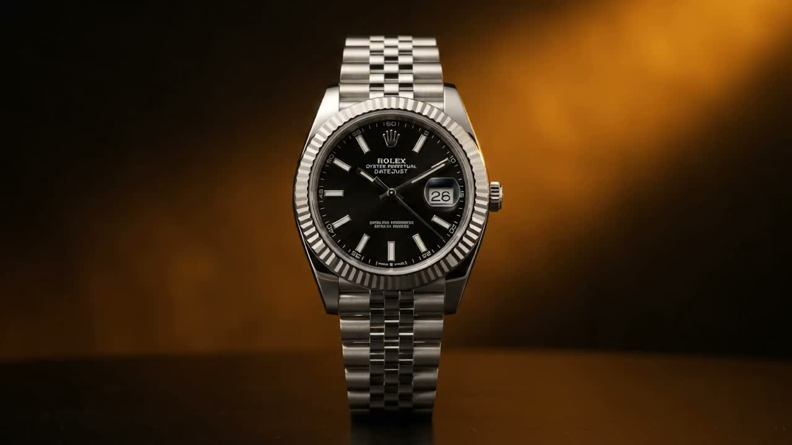

# Rolex Oyster Perpetual Datejust — The Anatomy of Excellence

<p align="center">
  
</p>

<p align="center">
  <strong>An ultra-high-fidelity interactive scrollytelling web experience & Atelier timepiece customizer.</strong><br/>
  Crafted with Vanilla JavaScript, HTML5 Canvas 2D sub-pixel interpolation, and Web Audio API Swiss escapement synthesis.
</p>

<p align="center">
  
  
  
  
  
</p>

<p align="center">
  🚀 <strong><a href="https://javedabubakar0-sketch.github.io/rolex-datejust-scrollytelling/">Experience the Live Website on GitHub Pages &rarr;</a></strong>
</p>

---

## 💎 Overview

The **Rolex Datejust Experience** is a tribute to the quintessential classic timepiece, widely celebrated as the archetype of the modern wristwatch since its introduction in 1945. 

This project delivers an apple-style luxury scrollytelling web experience featuring an orchestrated 240-frame mechanical breakdown, interactive atelier configuration, live mechanical sweep clock, and authentic procedural audio.

---

## ✨ Features

- **🎞️ 240-Frame Canvas Engine**: Ultra-smooth frame-by-frame canvas rendering driven by scroll position with responsive image scaling and retina display support.
- **⚡ Sub-Pixel LERP Dampening**: Custom linear interpolation (`current += (target - current) * 0.12`) rendering buttery 60fps / 120fps motion without scroll stutter.
- **🛰️ Dynamic Exploded HUD & Telemetry**: Live rotation angle computation, frame counter, and synchronized chapter milestones tracking every movement of the timepiece.
- **⏱️ Live Horological Sweep Clock**: Fully functional mechanical dial mirroring current local time with a fluid 28,800 VPH sweeping second hand, or switchable to the iconic press-shot `10:10:31` configuration.
- **🔊 Procedural Swiss Escapement Audio**: Pure Web Audio API synthetic escapement ticking at **28,800 beats per hour** (8 ticks per second / 4 Hz) using dual-pulse bandpass oscillators—zero external MP3/WAV assets needed.
- **🎨 Rolex Atelier Configurator**:
  - **Case Sizes**: 31 mm, 36 mm, 41 mm
  - **Dials**: Bright Black Sunray, Mint Green Fluted Motif, Silver Sunray, Wimbledon Slate, Azzurro Blue
  - **Bezels**: Smooth Domed Stainless Steel vs. Iconic Fluted 18 ct White Gold
  - **Bracelets**: Robust 3-piece Oyster vs. Supple 5-piece Jubilee
  - **Dynamic Spec & Pricing Matrix**: Real-time reference numbers, calibres (Calibre 3235 / 2236), and MSRP calculation.
- **📱 Ultra-Responsive Luxury Aesthetic**: Deep horological dark mode (`#030504`, Rolex Jubilee Gold `#C5A059`, Rolex Everose `#E8B89C`, and Emerald Green `#006039`).
- **🚀 Zero Dependencies**: Pure HTML5, Vanilla CSS3, and ES6+ JavaScript. No frameworks, no external runtime bundles, lightning-fast first paint.

---

## 📂 Project Structure

```text
rolex/
├── .github/
│   └── workflows/
│       └── deploy.yml        # Automated GitHub Pages CI/CD workflow
├── frames/                   # 240 high-fidelity macro sequence frames
│   ├── ezgif-frame-001.jpg
│   ├── ezgif-frame-002.jpg
│   └── ...
├── .gitignore                # Optimized Git exclusions
├── app.js                    # Canvas engine, LERP scroller, Web Audio & Atelier state
├── index.html                # Semantic HTML5 luxury scrollytelling document
├── LICENSE                   # Open-source MIT License
├── package.json              # Project manifest and dev commands
├── README.md                 # Project documentation & showcases
├── server.js                 # Zero-dependency Node.js HTTP dev server
└── style.css                 # Custom luxury design system & responsive styling
```

---

## 🚀 Quick Start

### Option 1: Direct File Preview
Simply double-click [`index.html`](index.html) or open it with any modern web browser. All assets, scripts, and audio synthesizers work locally with zero configuration.

### Option 2: Run with Local Node Server
A built-in zero-dependency static server with automatic port-clash resolution and image caching is included:

```bash
# Clone the repository
git clone https://github.com/javedabubakar0-sketch/rolex-datejust-scrollytelling.git

# Navigate to the folder
cd rolex-datejust-scrollytelling

# Launch the development server
npm run dev
# or
node server.js
```

Visit [`http://localhost:3030`](http://localhost:3030) in your browser.

---

## 🌐 Deploy to GitHub Pages (1-Click)

This repository includes a preconfigured GitHub Actions workflow ([`.github/workflows/deploy.yml`](.github/workflows/deploy.yml)).

1. Push your repository to GitHub:
   ```bash
   git remote add origin https://github.com/javedabubakar0-sketch/rolex-datejust-scrollytelling.git
   git push -u origin main
   ```
2. On GitHub, navigate to **Settings** > **Pages**.
3. Under **Build and deployment** > **Source**, choose **Deploy from a branch** (select `main` and `/(root)`) or **GitHub Actions**.
4. The live site will be accessible at:
   `https://javedabubakar0-sketch.github.io/rolex-datejust-scrollytelling/`

---

## 🛠️ Technical Specifications & Architecture

### 1. Canvas Frame Interpolation
The canvas viewport dynamically scales to device pixel ratio (`window.devicePixelRatio`) with high-DPI crispness. Frame indexes are determined by normalize scroll progress across the 400vh scroll track:

$$\text{frameIndex} = \lfloor \text{progress} \times (\text{TOTAL\_FRAMES} - 1) \rfloor$$

A continuous `requestAnimationFrame` loop blends the visual presentation using a 12% linear damping factor to prevent jarring jumps during rapid mouse-wheel or touch scrolling.

### 2. Procedural Escapement Synthesis (Web Audio API)
Rather than looping an audio sample, the mechanical ticking is generated mathematically:
- **Tick 1 (Pallet Jeweled Strike)**: 1200 Hz bandpass filter with high Q-factor and exponential decay (12ms).
- **Tick 2 (Discharge Impact)**: 850 Hz secondary harmonic pulse delayed by 18ms.
- Triggered 8 times per second (28,800 beats/hour) in synchronization with the sweep clock.

---

## ⚖️ Intellectual Property & Disclaimer

This project is an independent creative design demonstration and educational portfolio piece. 
- **ROLEX**, **OYSTER PERPETUAL**, **DATEJUST**, **JUBILEE**, and related trademarks and trade dress are registered trademarks of **Montres Rolex SA**.
- This project is **not** endorsed by, affiliated with, sponsored by, or directly connected to Montres Rolex SA or any of its subsidiaries.

---

## 📄 License

Distributed under the [MIT License](LICENSE).
